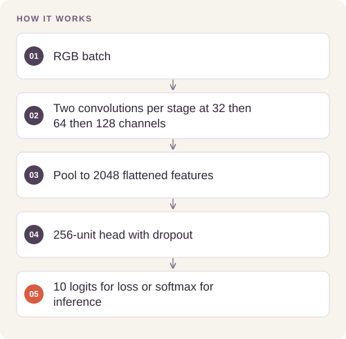

# CIFAR-10 Convolutional Classifier

Train a compact RGB image classifier with explicit separation of augmentation, model selection, and final test evaluation.

## Implementation

A three-stage RGB convolutional classifier with separate raw-logit training and probability inference interfaces.




## Train and evaluate the image model

The recovered compatible checkpoint reproduces **87.80% accuracy on all 10,000 CIFAR-10 test images** (cross-entropy0.37405). A strict parameter-name conversion preserves identical logits. The new reference trainer has fixed prepared splits, best-validation selection, resume/reload checks and held-out predictions.

[Commands, artifacts and benchmark scope](BENCHMARKS.md) · [Versioned profiles](reproduction.json)


## Try a small example

Generated tensors exercise logits, probability normalization and backpropagation. The example does not reproduce the historical 25-epoch accuracy.

After the local setup below, run from the repository root:

```sh
python examples/quickstart.py
```

The [example source](examples/quickstart.py), [captured output](examples/expected-output.txt) and [execution record](examples/environment.json) keep this demonstration inspectable. Floating-point values may vary with library versions.

Observed output from this run:

```text
{
  "logits_shape": [
    2,
    10
  ],
  "loss": 2.333203077316284,
  "probability_row_sums": [
    1.0,
    1.0
  ]
}
```

## Completed study

The saved 25-epoch experiment reports 87.80% accuracy on all 10,000 CIFAR-10 test images, with cross-entropy 0.3741. Per-class recall ranges from 72.0% for cats to 94.7% for ships.

These historical figures describe the completed study. This refactored standalone implementation has separate validation and has not been used to recertify the historical benchmark. The public release contains the portable core and focused tests.

## Run locally

Python 3.11 or later.

```sh
python -m venv .venv
source .venv/bin/activate
python -m pip install -r requirements.txt
python smoke_test.py
```

Prepare your own inputs as described in [DATA.md](DATA.md). Tests use generated fixtures and do not need credentials or provider calls. [VALIDATION.md](VALIDATION.md) records their scope.

## Practical relevance and limitations

These are saved results from one seed and one training budget. The full run expects CUDA. The release includes a CPU architecture check, not a new 25-epoch training claim.
